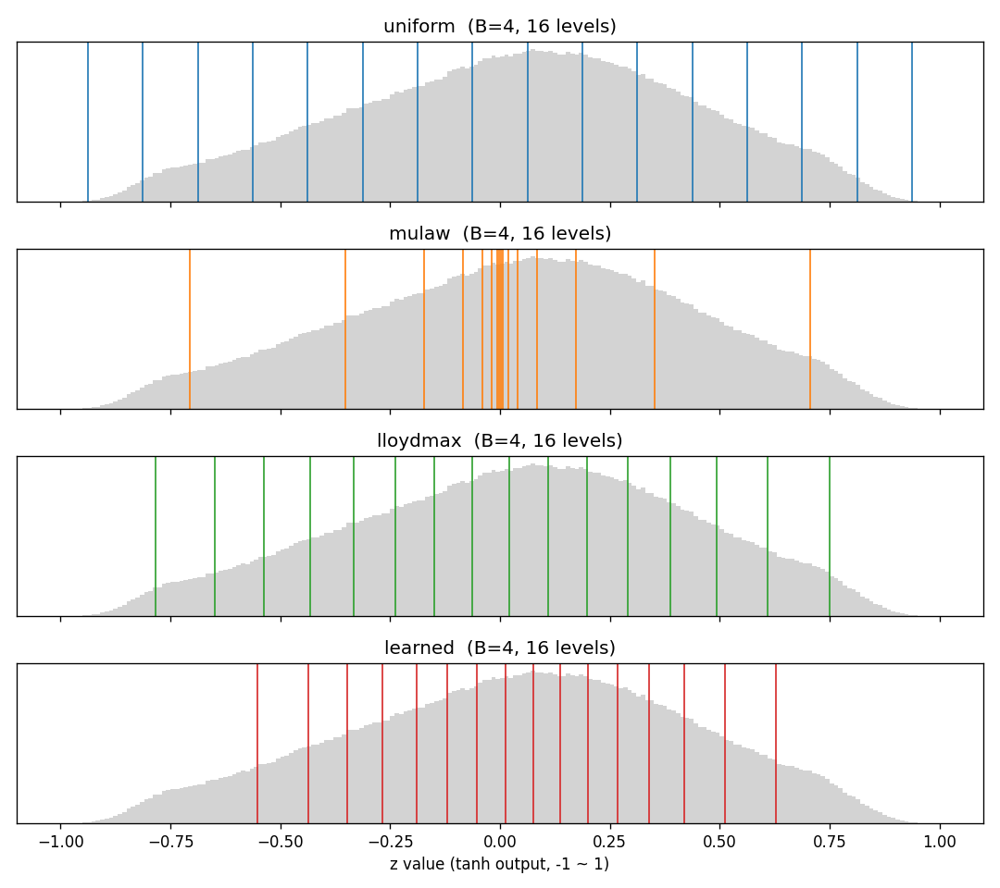
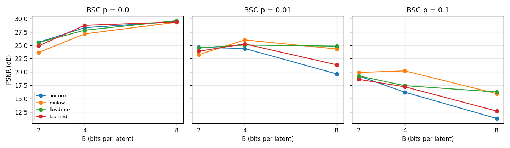

# Week 1 정답: 스칼라 양자화 + BSC 채널

```
이미지(3x32x32) -> Encoder -> tanh -> z (8x8x8, [-1,1])
      -> 양자화 인덱스 (B bit)  -> [비트스트림 -> BSC(p) -> 비트스트림] -> z_q -> Decoder -> 복원 이미지
```

설치 방법은 최상위 `README.md`를 참고하세요.

## 파일

| 파일 | 내용 |
|---|---|
| `models/scalarquantizer.py` | **WCML PROJECT 블록**: uniform / μ-law / Lloyd-Max / learned(직접 설계) 양자화 |
| `models/channel.py` | 인덱스 ↔ 비트스트림 변환, BSC(p), Gray 코드 |
| `models/vqvae.py` | Encoder → tanh → ScalarQuantizer → Decoder |
| `main.py` | 학습 + 테스트, 체크포인트 저장 (`checkpoints/{method}_B{B}.pth`) |
| `week1_experiment.py` | method × B × p 표, 복원 이미지 그림 (`results/`) |
| `check_week1.py` | 자가 채점 (작은 예제로 각 함수 확인) |
| `check_ste.py` | STE 있음/없음 기울기 비교 (보고서 2번) |
| `show_levels.py` | 방법별 레벨 vs z 분포 그림 (보고서 3번) |
| `checkpoints/` | 학습해 둔 12개 모델 (4 방법 × B=2,4,8). Week 2에서도 사용 |

## 양자화 방법 요약

- **uniform**: [-1,1]을 2^B칸으로 나누고 칸 가운데 값으로 복원
- **mulaw**: `F(z)=sgn(z)ln(1+μ|z|)/ln(1+μ)` (μ=255)로 압축 → 균일 양자화 → 역함수로 신장. 0 근처에 레벨이 몰림
- **lloydmax**: 학습 중엔 배치마다 Lloyd 1회 업데이트, 학습이 끝나면 학습셋 latent 전체로 Lloyd 알고리즘 100회 반복
  (경계 = 레벨 중간점, 레벨 = 구간 평균). 레벨은 `lm_levels` buffer로 체크포인트에 저장
- **learned** (your own): 레벨 2^B개를 `nn.Parameter`로 두고 VQ-VAE처럼
  `||sg(z) - z_q||² + β||z - sg(z_q)||²` loss로 end-to-end 학습

### `z_q = z + (z_q - z).detach()` (Straight-Through Estimator)

- **의미**: forward 값은 `z_q`, backward 기울기는 `z`의 기울기(=1)를 그대로 사용
- **역할**: 양자화(round/argmin)는 미분값이 거의 모든 곳에서 0이라 Encoder로 기울기가 흐르지 않음 → 양자화를 항등함수로 보고 기울기를 통과시킴
- **필요성**: 없으면 Decoder만 학습되고 Encoder는 전혀 학습되지 않음

`python check_ste.py` 결과 (보고서 2번 모범 답안의 근거):

| 층 | STE 있음 | STE 없음 |
|---|---|---|
| Encoder | 0.00063 | **0.00000** |
| Decoder | 0.14006 | 0.14006 |

STE가 없으면 Encoder 기울기가 정확히 0 → optimizer가 Encoder를 전혀 움직이지 못함.
Decoder는 양자화 뒤에 있어서 STE와 상관없이 같은 기울기를 받는다.

### 전송 비트 수 (transmission overhead)

latent = 8채널 × 8 × 8 = 512개 값 → **이미지당 512·B bit**

| B | bit/image | 원본(3×32×32×8 = 24576 bit) 대비 |
|---|---|---|
| 2 | 1024 | 24× 압축 |
| 4 | 2048 | 12× 압축 |
| 8 | 4096 | 6× 압축 |

## 실행 예시

`week1` 폴더에서 (`cd week1`):

```
python check_week1.py            # 18/18 통과 (GPU가 있으면 19/19)
python check_ste.py              # 보고서 2번
python show_levels.py            # 보고서 3번 -> results/levels_B4.png

# 저장된 모델로 테스트만
python main.py --method lloydmax --B 4 --test_only

# 표 + 그림 (B ∈ {2,4,8}, p ∈ {0, 0.01, 0.1})
python week1_experiment.py
python week1_experiment.py --gray          # Gray 코드 비트 매핑과 비교

# 다시 학습하고 싶으면 (CPU로 모델당 약 4~10분, Miniforge Prompt = cmd 문법)
for %m in (uniform mulaw lloydmax learned) do for %b in (2 4 8) do python main.py --method %m --B %b
```

결과: `results/table.md`, `results/psnr.png`, `results/recon_{method}.png`, `results/levels_B4.png`



PSNR은 이미지를 [0,255]로 바꿔 계산, MSE는 픽셀 [0,1] 스케일 기준입니다.

## 결과 (CPU, 모델당 3000 updates ≈ 4 epoch, CIFAR-100 test 10000장 평균)

> 학습이 짧아서 방법 간 0.5 dB 이내 차이는 학습 편차 수준입니다. GPU로 오래 학습하면 전체적으로 올라갑니다.

PSNR (dB), 자연 이진(natural binary) 비트 매핑:

| method | B=2 p=0 | 0.01 | 0.1 | B=4 p=0 | 0.01 | 0.1 | B=8 p=0 | 0.01 | 0.1 |
|---|---|---|---|---|---|---|---|---|---|
| uniform  | **25.58** | **24.61** | 19.24 | 28.30 | 24.40 | 16.20 | 29.45 | 19.63 | 11.27 |
| μ-law    | 23.66 | 23.25 | **19.91** | 27.14 | **26.01** | **20.20** | 29.33 | 24.31 | 15.93 |
| Lloyd-Max| 25.52 | 24.54 | 19.25 | 27.83 | 25.05 | 17.43 | **29.62** | **24.84** | **16.24** |
| learned  | 24.90 | 23.89 | 18.60 | **28.75** | 25.26 | 17.22 | 29.37 | 21.34 | 12.66 |

Gray 코드 매핑 (`--gray`), p > 0만:

| method | B=2 p=0.01 | 0.1 | B=4 p=0.01 | 0.1 | B=8 p=0.01 | 0.1 |
|---|---|---|---|---|---|---|
| uniform  | 24.37 | 18.45 | 25.06 | 17.03 | 21.62 | 12.99 |
| μ-law    | 22.83 | 17.95 | 25.02 | 17.53 | 23.68 | 14.88 |
| Lloyd-Max| 24.30 | 18.45 | 25.15 | 17.46 | 24.22 | 15.34 |
| learned  | 23.85 | 18.32 | 25.46 | 17.34 | 22.64 | 13.78 |



### 관찰

1. **채널이 깨끗할 때 (p=0)**: B가 클수록 좋아지지만 B=4 → 8은 +1 dB 정도로 포화.
   이 구간의 병목은 비트 수가 아니라 latent 크기(8×8×8)와 Decoder 성능.
2. **B=2, 4**: uniform / Lloyd-Max / learned가 비슷하고 μ-law가 가장 나쁨. μ=255는 레벨을 0 근처에 너무 몰아서
   (B=4일 때 최대 레벨 0.71) tanh latent 분포와 맞지 않음. Lloyd-Max 레벨은 [-0.78, 0.75]에 고르게 퍼짐.
3. **비트 에러가 있을 때 (p>0)**: **B가 클수록 오히려 나빠짐** (uniform B=8 p=0.1 → 11.3 dB).
   값 하나가 에러를 맞을 확률이 `1-(1-p)^B`로 커지고, MSB 한 개만 뒤집혀도 값이 ~1만큼 튀기 때문.
   → 채널이 나쁘면 비트를 해상도가 아니라 **보호**(채널 코딩)에 써야 함.
4. **μ-law는 비트 에러에 강함** (B=4 p=0.01: 26.0 dB vs uniform 24.4 dB): μ-law 레벨은 대부분 0 근처에 몰려 있고
   가장 큰 레벨도 0.71이라, 비트가 뒤집혀 다른 레벨로 가도 값이 튀는 폭이 uniform(최대 ~2)보다 작음.
   깨끗한 채널에서는 손해였던 성질이 잡음 채널에서는 이득이 됨.
5. **Gray 코드**: uniform / Lloyd-Max / learned의 B≥4에서는 좋아짐 (uniform B=8 p=0.01: 19.6 → 21.6 dB).
   Gray 코드에서 MSB가 뒤집히면 레벨 k → 2^B-1-k (0을 기준으로 뒤집기)가 되어, 0 근처 값은 조금만 변함.
   하지만 μ-law와 B=2에서는 오히려 나빠짐. 어떤 비트가 뒤집힐 때 얼마나 튀는지를 레벨 배치별로 계산해 보는 것이
   좋은 추가 과제 (비트 위치별 평균 오차 표).

## ref 코드 대비 수정한 점

- `ScalarQuantizer.forward`: 주석엔 `(B,H,W,C)`로 reshape한다고 되어 있는데 코드가 빠져 있어서
  마지막 `permute(0,3,1,2)`와 짝이 맞지 않았음 → 앞에 `z.permute(0,2,3,1)` 추가
- `metrics.py`: `einops`, `pytorch_fid` 의존성 제거 (PSNR만 사용)
- `main.py`: 매 스텝 `next(iter(loader))` 대신 무한 반복 로더 사용, method/B/ckpt를 argparse로
- `main_v2.py`의 `model.pre_quantization_conv(x)` (x가 아니라 z_e여야 함) 버그는 `model.encode()`로 대체
- 데이터/체크포인트/결과 경로는 파일 위치 기준 (CIFAR-100은 최상위 `data/` 공용)
